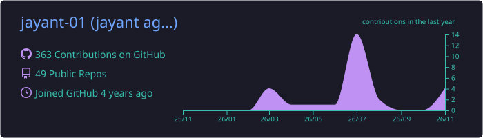
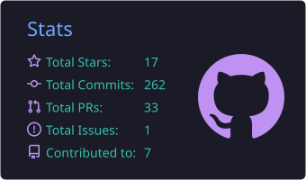
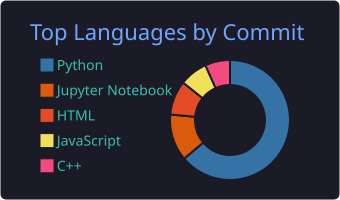

<!-- ───────────────────────── Header ───────────────────────── -->
<p align="center">
  
</p>

<p align="center">
  <a href="https://github.com/DenverCoder1/readme-typing-svg">
    
  </a>
</p>

<p align="center">
  <a href="https://www.linkedin.com/in/jayant-agarwal-84536a22a/"></a>
  <a href="https://x.com/Jayant01agarwal"></a>
  <a href="https://leetcode.com/u/jayant_01"></a>
  <a href="mailto:01agarwal.jayant@gmail.com"></a>
  
</p>

<p align="center">
  
  <a href="https://github.com/jayant-01?tab=followers"></a>
</p>

---

### 👋 About me

I'm a developer who lives where **security, AI and finance** overlap. I build recon and OSINT tools,
AI pipelines that show their sources instead of guessing, and quant systems I can backtest from start to finish.

```python
class Jayant:
    focus      = ["Cybersecurity", "OSINT", "AI / RAG", "Quant Finance"]
    shipping   = ["Python", "FastAPI", "Flask", "Streamlit", "Flutter"]
    learning   = ["Go", "Rust", "AWS"]
    off_hours  = "CTFs (picoCTF) & breaking my own projects"
```

---

### 🚀 Featured projects

<table>
  <tr>
    <td width="50%" valign="top">
      <h4>🚔 <a href="https://github.com/jayant-01/crime-craft">Crime Craft</a></h4>
      <p>Multilingual, role-aware conversational AI for the <b>Karnataka State Police</b> datathon. It turns thousands of case records into insights, with PII redaction and ~108 tests.</p>
      
      
      
    </td>
    <td width="50%" valign="top">
      <h4>🔎 <a href="https://github.com/jayant-01/enterprice-ai">Enterprise Research Pipeline</a></h4>
      <p>An auditable research engine. It decomposes a question, then searches, extracts, grades evidence and detects contradictions. <b>Every conclusion traces back to exact characters in its source.</b></p>
      
      
    </td>
  </tr>
  <tr>
    <td width="50%" valign="top">
      <h4>📈 <a href="https://github.com/jayant-01/quant-finance">Quant Finance Pipeline</a></h4>
      <p>A 9-level quant stack, from raw data to signals, strategy, backtest, position sizing, risk and live paper trading. One command runs the whole pipeline.</p>
      
      
    </td>
    <td width="50%" valign="top">
      <h4>🕵️ <a href="https://github.com/jayant-01/company-osint">Company OSINT</a></h4>
      <p>Give it company names. It finds their sites, careers pages, ATS providers, jobs, contacts, tech stacks and firmographics, with optional local-AI job scoring.</p>
      
      
    </td>
  </tr>
  <tr>
    <td width="50%" valign="top">
      <h4>🛰️ <a href="https://github.com/jayant-01/cyber-threat-intelligence">Domain Recon AI Agent</a></h4>
      <p>Recon for bug bounty hunters: WHOIS, DNS, subdomains, tech fingerprinting, TLS, security headers and known-vuln lookups through Shodan, VirusTotal and Censys.</p>
      
      
    </td>
    <td width="50%" valign="top">
      <h4>⚡ <a href="https://github.com/jayant-01/cursor_mini">Cursor-Mini</a> · <a href="https://cursor-mini.streamlit.app/">live demo ↗</a></h4>
      <p>Describe a project and get a complete, structured codebase to download as a ZIP. A pocket-sized version of AI code scaffolding.</p>
      
      
    </td>
  </tr>
</table>

<details>
<summary><b>More things I've built</b></summary>
<br/>

| Project | What it does |
|---|---|
| [live-traffic-visualizer](https://github.com/jayant-01/live-traffic-visualizer) | Chrome extension and Flask WebSocket backend that maps a website's visitors in real time |
| [code_mate](https://github.com/jayant-01/code_mate) | Turns a project description into code and creates and pushes the GitHub repo for you |
| [Algorithmic_trading](https://github.com/jayant-01/Algorithmic_trading) | "Company Stock Khundli": Streamlit app for stock info, MA50/MA200 and trend prediction |
| [RAG-from-scratch](https://github.com/jayant-01/RAG-from-scratch) · [Ml-from-scratch](https://github.com/jayant-01/Ml-from-scratch) | Building retrieval and ML fundamentals without frameworks |
| [bash-scripting](https://github.com/jayant-01/bash-scripting) · [picoctf](https://github.com/jayant-01/picoctf) | Shell automation and CTF write-ups |

</details>

---

### 🛠️ Tech stack

<p align="center">
  <b>Languages</b><br/><br/>
  
</p>
<p align="center">
  <b>Frameworks & AI</b><br/><br/>
  
</p>
<p align="center">
  <b>Security, DevOps & Tools</b><br/><br/>
  
</p>

---

### 📊 GitHub activity

<p align="center">
  
</p>
<p align="center">
  
  
</p>
<p align="center">
  
</p>

<p align="center">
  <picture>
    <source media="(prefers-color-scheme: dark)" srcset="https://raw.githubusercontent.com/jayant-01/jayant-01/output/github-snake-dark.svg"/>
    <source media="(prefers-color-scheme: light)" srcset="https://raw.githubusercontent.com/jayant-01/jayant-01/output/github-snake.svg"/>
    
  </picture>
</p>

---

### ⚡ Right now

- 🔭 Building **auditable AI research pipelines** and a **live-capable quant trading system**
- 🌱 Learning **Go**, **Rust** and **AWS**
- 🤝 Open to collaborating on **security tooling, OSINT and AI agents**
- 💬 Ask me about **pentesting, OSINT, Python or RAG**

<p align="center">
  
</p>
